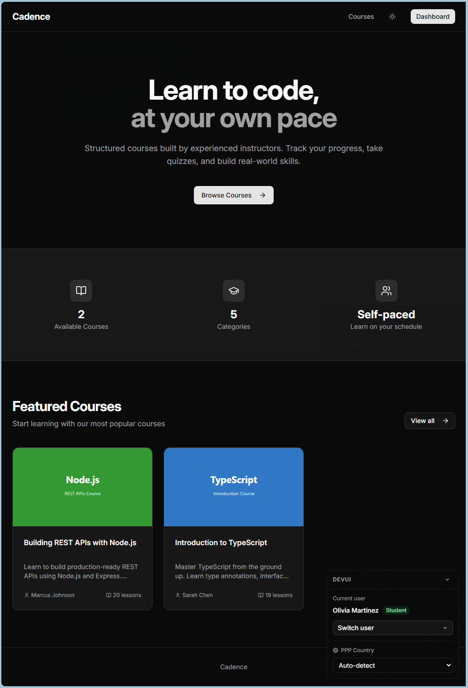

# Using the `/teach` skill to learn a codebase

This repo is a teaching workspace for learning the [ai-coding-crash-course](https://github.com/ai-hero-dev/ai-coding-crash-course) repo. Matt Pocock's [`/teach` skill](https://github.com/mattpocock/skills/blob/main/skills/productivity/teach/SKILL.md) creates the lessons, reference sheets, and learning records here. Read the lessons at [michellepace.github.io/ai-coding-teach](https://michellepace.github.io/ai-coding-teach/).

*The prompt that starts lesson 1:*

```markdown
/teach Teach me about this repo:
`~/projects/others/ai-coding-crash-course/` I've done a little bit of
vibe coding before. I know the basics of TypeScript. I've never worked
in React before, and I'm not very clear about client and server, and
certainly not about the database.

The crash-course repo has three parts:
1. Course platform (React) — focus here; a mini-Udemy the lessons change
2. `request-logger/` — ignore; records what Claude Code sends Anthropic
3. `lessons/` — optional, likely not useful; the scraped course lessons
```

&nbsp;

*The course platform (the app the prompt focuses on):*

<a href="images/course-platform.jpg">
  
</a>
